  

↳ <a href="https://doi.org/10.5281/zenodo.20340668">experimental study · doi:10.5281/zenodo.20340668</a> · <a href="https://doi.org/10.5281/zenodo.18485575">theoretical framework · doi:10.5281/zenodo.18485575</a>

↳ <a href="https://doi.org/10.5281/zenodo.19298046">technical report · doi:10.5281/zenodo.19298046</a> · <a href="https://dcei.filtree.in">live dashboard</a>

↳ <a href="https://arxevo.filtree.in">arxevo</a> · <a href="https://filtree.in">filtree</a> · <a href="https://crimescope-ai.streamlit.app">crimescope-ai</a> (<a href="https://github.com/rudra6155/crimescope-ai">code</a>) · <a href="https://dcei.filtree.in">dcei</a> · <a href="https://geology.filtree.in">geology</a>

<code>$ cat resume.txt</code> &nbsp;(plain-text version)

 

**Rudra Kumar Sudhir Singh** · Mumbai, India · rudra@filtree.in
High school engineer specializing in AI systems and GPU optimization. I build from scratch, bypassing high-level frameworks to profile hardware bottlenecks.

**AI infrastructure & systems**
- **LLM Inference Engine** (C++, Triton, CUDA, PyTorch): 4-bit Qwen2.5-3B at 74.14 tok/s on an 8GB RTX 4060 (5.7× over baseline PyTorch). Found an 81% Python launch overhead (1,630 Triton kernels per token, ~45µs each) and removed it with a CUDA Graph decode pass with device-side KV indexing. BLOCK_N=128 coalesced Triton kernels and a C++/CUDA RMSNorm reach 62.3% of the memory-bandwidth ceiling; p99 latency 108ms → 14.2ms.
- **Kernel-Gen-LLM** (PyTorch, Triton, QLoRA, GRPO): Qwen2.5-Coder-3B fine-tuned to write Triton kernels: 96% Pass@1, 2.39× geomean speedup on 50 held-out tasks. Benchmark harness with AST allowlists and ATen dispatcher interception. Diagnosed reward hacking (peak 11.8× reward from invalid kernels) and rolled back to the SFT checkpoint.
- **Redis-RS** (Rust, Tokio): wire-compatible RESP2 server, 199/199 byte-for-byte oracle cases vs redis:7.4.12; AOF crash recovery; 2.66× SET / 2.33× GET vs native Redis at 4 client threads; mutation testing caught 15/15 injected bugs.

**Neurotech & applied ML**
- **Real-Time BCI Pipeline**: 64-channel EEG, sub-10ms end-to-end (p99 7.4ms), O(1) lock-free ring buffer, dual CUDA streams, <0.1ms LSL jitter, closed-loop cursor control; κ 0.587 on BCICIV 2a without EOG removal (matches the 2008 winner).
- **EEG-MOABB**: tangent space κ 0.633 vs CSP+LDA 0.490 (peak 88.9%, Subject 8); leakage audit with 8 injected leaks; label-shuffle control 24.8–25.9% vs 25.0% chance; Leave-One-Run-Out.

**Robotics**: ROS2 + C++ navigation stack without Nav2: octile A*, 20Hz pure pursuit, 2° LiDAR binning, TF2 log-odds mapping; 100% success over 40 randomized Gazebo episodes, 0 collisions; fault injection to 0.27 RTF; headless Docker CI.

**Core ML**: GPT from scratch (163,000 tok/s, byte-level BPE, Jacobian causality check, learned vs sinusoidal positions 3.153 vs 3.186). ResNet-18 on CIFAR-10: 95.39% ± 0.21% over 3 seeds, bit-exact; traced the 93.02% baseline to a community repo (+2.37pp).

**Research (lead author, preprints)**
- Acoustic Agglomeration for PM2.5 Mitigation: Experimental Validation, 88.2% reduction at 1.421 kHz. [doi:10.5281/zenodo.20340668](https://doi.org/10.5281/zenodo.20340668)
- Synergistic PM2.5 Mitigation Using Acoustic Agglomeration and Botanical Trapping. [doi:10.5281/zenodo.18485575](https://doi.org/10.5281/zenodo.18485575)
- DCEI: A Data Center Environmental Impact Index for India. [doi:10.5281/zenodo.19298046](https://doi.org/10.5281/zenodo.19298046)

**Experience**: AKIYAM Technologies, Software Engineering Intern, Integration & Data Engineering (Sep 2026 – present) · Akiyam Solutions, Backend Engineering Intern, Platform & Infrastructure (Apr 2026 – present) · Stick & Dot Media, AI/ML Development Intern (Apr 2026 – present) · Space Food Club, Space Food Development Intern (Apr – May 2026)

**Ventures**: ARXEVO (founder) · Filtree (founder & lead developer) · CrimeScope AI · DCEI Dashboard · Geology Study Platform

**Education**: St. Xavier's College, Mumbai, HSC Science (2025–2027) · St. Aloysius High School, SSC 93% (2025)
**Certifications**: CS50P, CS50AI (Harvard) · Satellite Technology & Communication Workshop (B. A. Subramani, former ISRO scientist) · Robotics Workshop (iRobo Chakra) · HACCP (Space Food Club)
**Honours**: Junior Academy Fellow, New York Academy of Sciences · AI Olympiad, high national rank (TalentSpirit & Accenture, 2025) · AI/ML Advanced Programme, IIT Roorkee & BITS Pilani (2025) · IESO national exam participant (2026)

 

every animation above is a hand-built SVG — no GIFs, no JavaScript · generated by <a href="scripts/claudia">scripts/claudia</a>

